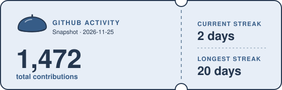
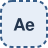
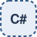

# Kota Mizobuchi / Buchi

*The Engineer in the Beret.*

I’ve been programming since I was a kid. I’m now studying design,
technology, and entrepreneurship at Kamiyama Marugoto College.

Learning design changed the questions I ask when I code. I still enjoy
figuring out how to make something work, but now I ask myself another question:

> What would make this fun to use?

That’s where I find joy in making things: in figuring them out and in
seeing someone enjoy using them.

## GitHub Activity

<!-- Manual snapshot, not live. Refresh with: node scripts/beret-ticket.mjs (data: streak-stats.demolab.com type=json) -->

[Contribution activity](https://github.com/Buchi-dev-dzn?tab=overview#js-contribution-activity)

## Technologies & Tools

<!-- Logo tiles: local assets; sources and licenses in assets/icons/ATTRIBUTION.md. Dashed tiles are custom lettermarks, not official logos. -->

**Design & Media**

**Web & Mobile**

**Languages**

**Tools**

